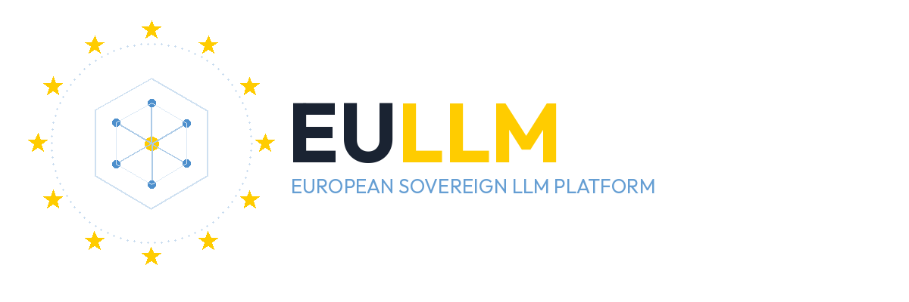

<p align="center">
  <picture>
    <source media="(prefers-color-scheme: dark)" srcset="eullm-logo-github-dark.png" />
    
  </picture>
</p>

<h3 align="center">Local AI that decides in milliseconds — on your hardware, trained for your domain.</h3>

<p align="center">One Rust binary · OpenAI- and Ollama-compatible API · no telemetry, no external API · an audit trail designed for the EU AI Act</p>

<p align="center">
  <a href="#try-it-now">Try it now</a> ·
  <a href="#decisions-in-milliseconds-all-local">Decisions</a> ·
  <a href="#runs-everywhere-from-an-arm-board-to-a-supercomputer">Runs everywhere</a> ·
  <a href="#models-trained-for-your-needs">Your own models</a> ·
  <a href="#documentation">Docs</a> ·
  <a href="https://eullm.eu">Website</a>
</p>

<p align="center">
  
  
  
  
  <a href="https://github.com/eullm/eullm/actions/workflows/ci.yml"></a>
  <a href="https://doi.org/10.5281/zenodo.20412979"></a>
</p>

<p align="center">
  🔒 Local-first and sovereign by design &nbsp;·&nbsp; 🇪🇺 Tested on EuroHPC supercomputers &nbsp;·&nbsp; 🇮🇹 Developed in Italy
</p>

<p align="center">
  <sub><strong>AGPL-3.0-or-later.</strong> Copyright held by <strong>I3K Technologies Srl</strong>, which also offers EuLLM under a separate <a href="#license">commercial licence</a>. Contributions require the <a href="CLA.md">CLA</a>.</sub>
</p>

---

## EuLLM at a glance

| | |
|---|---|
| ⚡ **Decisions in milliseconds** | 64 questions about a page in 0.66 s, about 10 ms each, on one RTX 5070 Ti. The model gives the probability of every option and generates nothing. |
| 🎯 **A RAG gate that knows when to stop** | On Italian law it tells whether the retrieved text can answer: AUROC 0.90 against 0.79 for embeddings, and 2.5× fewer good answers blocked (Jev-Style 2B). |
| 🔁 **The same question, the same answer** | A decision does not move with the other questions asked beside it: bit for bit, checked on CPU and GPU. |
| 🧾 **Decisions you can audit, correct and learn from** | Every decision has an id in the local audit trail. Mark it right or wrong, keep a private trace, and train your own decision model with Forge. |
| 🐘 **A 125B model on a 16 GB GPU** | Qwen3.8-Flash-Next (125B, 6B active, IQ2_XS) writes 69 tokens/s on an RTX 5070 Ti with 64 GB of RAM: about 3× the usual split, and a 30,000-token prompt is read about 6× faster (1,570 tokens/s). |
| 🚀 **Up to 62% faster answers** | `--mtp` lets the model draft its own next tokens: +62% on code, +27% on prose with Qwen3.5-9B. |
| 👥 **A long prompt never freezes the others** | With two slots, an 8,000-token prompt is read in 1.5 s while another answer keeps streaming; its longest pause is 108 ms. |
| 📈 **Sixteen users, one GPU** | Continuous batching: Qwen3-8B writes 1,065 tokens/s across 16 concurrent requests on one desktop RTX 5070 Ti, 8× one request alone, and 1,434 on one GH200 (EuroHPC JUPITER). |
| 🧠 **Several models, one server** | Chat models, an embedder and a decision model stay loaded side by side, each sized to the VRAM the others leave. |
| 🖥️ **A chat and a live monitor, built in** | Open `http://localhost:11435/`: a chat with its history kept in your browser, each answer's speed and the model's reasoning, every sampling setting, a **Model hub** to find, download and manage models, and a Monitor with every request, GPU load, VRAM, temperature and power as they happen. Nothing to install, nothing sent anywhere. |
| 📂 **Your model folders, used as they are** | Point `EULLM_MODEL_LIBRARIES` at LM Studio's folder or a Hugging Face cache: every GGUF in it, at any depth, runs by name, and nothing in it is moved or changed. |
| 🔌 **A drop-in for Ollama and OpenAI** | The same API on port 11434: Open WebUI, LangChain, n8n and any OpenAI client work unchanged. |
| 🔒 **Nothing leaves your machine** | No telemetry, no external API. Every answer and every decision goes to a local audit trail: model, tokens, timing, never the text. |
| 🌍 **From an ARM board to a supercomputer** | A 35B MoE at 10.8 tokens/s on an ARM board's CPU alone; tested on EuroHPC Leonardo, LUMI and JUPITER. |
| 🎓 **Models trained for your domain** | EuLLM Forge turns a large open model into a small specialist you own. Italian law comes first: `legal-it-8b` is a Mistral model trained on EuroHPC Leonardo, European end to end. |

Where each number comes from: [decisions](docs/engine-guide.md#decisions-without-generation-v1systemone-new-in-v0720) ·
[RAG gate](docs/reflex-roadmap.md#rag-gate-italian-legal-set--rtx-5070-ti-jev-style-2b) ·
[MoE on small GPUs](docs/engine-guide.md#writing-faster-the-expert-cache---moe-cache-experimental) ·
[MTP](docs/engine-guide.md#speculative-decoding-with-the-models-mtp-head---mtp-n) ·
[long prompts](docs/roadmap-engine-0.7-1.0.md) ·
[batching](docs/benchmarks.md#data-centre-gpus-october-2026) · [ARM and EuroHPC](docs/platforms.md).
The expert cache needs one CUDA GPU and is experimental.

## Decisions in milliseconds, all local

<p align="center">
  <a href="https://github.com/user-attachments/assets/fa7c94c0-56a3-4329-a106-9ec2c1b643ef">
    
  </a>
  <br>
  <sub>▶ <a href="https://github.com/user-attachments/assets/fa7c94c0-56a3-4329-a106-9ec2c1b643ef">The whole game, one minute</a></sub>
</p>

A small model decides every move of this game of Snake on one RTX 5070 Ti,
**fast enough for the game to run in real time**. Nothing is
generated: EuLLM's [`/v1/systemone`](docs/engine-guide.md#decisions-without-generation-v1systemone-new-in-v0720)
reads, straight from the model, the probability of every option, and writes
each decision to the audit trail. No cloud, no external API.

Snake is only the part you can watch. The same call turns any state into a
structured decision:

| The state | The decision |
|---|---|
| a support ticket | route, escalate or close |
| an incoming email | which team, how urgent, legitimate or phishing |
| a document | accept, reject or send to review |
| an agent's state | its next tool or action |

Up to 64 questions about the same document go in one request: 64 questions
about a one-page document take 0.66 s with the Jev-Style 2B on the same GPU.
Try the [Snake and email triage examples](examples/README.md).

## Why EuLLM

- **100% local.** Prompts, documents and decisions never leave your
  machine: no telemetry, no external API, and every answer and decision
  written to a local audit trail (model, tokens, timing, never the text),
  designed for the EU AI Act's record-keeping.
- **A drop-in replacement.** The Ollama and OpenAI APIs on port 11434:
  Open WebUI, LangChain, n8n and any OpenAI client work unchanged.
- **Fast where it counts.** Continuous batching serves 16 users at once at
  1,065 tok/s on a desktop RTX 5070 Ti and 1,434 tok/s on one GH200; quantized
  KV cache for long contexts; images and audio as input; large MoE models on
  small GPUs.
- **Runs everywhere.** From a Raspberry Pi to a GH200 node, with CUDA, ROCm,
  Vulkan, Metal and CPU builds of the same engine.
- **Models trained for your needs.** EuLLM Forge turns a general open model
  into a small specialist for your domain, your language and your brand,
  trained on European infrastructure and delivered as a file you own.

## Try it now

Download one binary, run any GGUF model (Qwen, Mistral, DeepSeek, Gemma, …)
and talk to it with the tools you already use:

```bash
# Linux / macOS: detects the OS and an NVIDIA GPU, checks the release checksums
curl -fsSL https://raw.githubusercontent.com/eullm/eullm/main/installer/install.sh | sh
eullm run hf.co/Qwen/Qwen3-8B-GGUF:Q4_K_M
```

```powershell
# Windows (PowerShell)
irm https://raw.githubusercontent.com/eullm/eullm/main/installer/install.ps1 | iex
```

```bash
# The same API your existing tooling already speaks
curl http://localhost:11434/v1/chat/completions \
  -H "Content-Type: application/json" \
  -d '{"model": "qwen3", "messages": [{"role": "user", "content": "Ciao!"}]}'
```

A chat UI opens on `http://localhost:11435/`, with `eullm run` and with
`eullm serve` alike (`--no-ui` turns it off). Its sidebar keeps your recent
chats (in the browser only) and opens the **Model hub** (the models on this
machine, and Hugging Face's GGUF models to download, each judged against your
VRAM and RAM). Beside the chat: the
**Parameters** panel (system prompt, reasoning, temperature, top P/K, min P,
repeat penalty, seed), the **Monitor** (requests, speed, CPU, memory, and each
GPU's load, VRAM, temperature, power and PCIe traffic over the last two
minutes) and **About** (the build, the hardware llama.cpp sees, where models
and the audit trail are kept, who may use the server). No Python, no Docker,
no account. Every download, for every platform: [platforms](docs/platforms.md).

`eullm --help` shows the ways to start, the options used most with their
defaults, and every setting read from the environment or `.env`; `eullm run
--help` has every option, grouped. The [quick start](docs/quickstart.md) says
which to use, with startup scripts to copy.

## Runs everywhere: from an ARM board to a supercomputer

| Where | Measured |
|---|---|
| A desktop GPU, RTX 5070 Ti | 64 decisions in 0.66 s; qwen3-8b at 132 tok/s, 1,065 tok/s across 16 concurrent requests; a 125B MoE at 69 tok/s |
| An ARM board, no GPU: Radxa Orion O6 | a 35B MoE model (`qwen3.6-35b-a3b`) at 9–11 tok/s, on CPU alone |
| The same board with an RTX 3060 | qwen3-14b at 33 tok/s; qwen3.6-35b-a3b at 35.6 tok/s |
| EuroHPC **Leonardo**, NVIDIA A100 64 GB | a 27B model (Q8) at 32.4 tok/s on one GPU; the 125B MoE at 39 tok/s on one GPU |
| EuroHPC **LUMI-G**, AMD MI250X | qwen3-8b at 114 tok/s on one GCD, 958 tok/s across 32 requests; gpt-oss-120b at 1,181 tok/s on one node |
| EuroHPC **JUPITER**, NVIDIA GH200 (ARM) | qwen3-8b at 229 tok/s on one GPU, 1,434 tok/s across 16 requests; qwen3-32b at 875 tok/s across 32 |

Also on Apple Silicon (Metal), Intel Macs, Windows, and AMD and Intel GPUs
through Vulkan, with an experimental ROCm build for recent Radeons on Windows.
Details, and who tested what:
[platforms](docs/platforms.md) · [ARM](docs/platforms.md#arm) ·
[EuroHPC](docs/platforms.md#data-centre-gpus-and-eurohpc) ·
[benchmarks](docs/benchmarks.md) · [LUMI](docs/lumi/allocation-plan.md) ·
[JUPITER](docs/jupiter/dossier.md#51-eullm-engine-on-gh200-deliverable-5).

## Models trained for your needs

A general model knows a little about everything. **EuLLM Forge** makes a
small one that knows your field: it prunes a large open model, distils it
into a smaller student, teaches it your domain, your language and your name,
and quantizes it into a GGUF that runs on a laptop with 8 GB of RAM. Your
brand is in the weights, not in a system prompt anyone can remove.

The first are for Italian law: **[`legal-it-8b`](https://huggingface.co/EuLLM/legal-it-8b)**
and **[`legal-it-4b`](https://huggingface.co/EuLLM/legal-it-4b)**, published on
Hugging Face. **`legal-it-8b` is European end to end**: it starts from
Ministral-3-8B by Mistral AI (Paris, Apache 2.0) and was trained in Italy on
the EuroHPC supercomputer Leonardo, on public Italian legislation only.
`legal-it-4b` starts from Qwen3-4B-Instruct-2507; both were trained with
supervised fine-tuning, then GRPO. They
answer from the legal texts a retrieval system puts in the prompt and cite
them: 89.0% and 85.1% on 429 held-out questions, against 80.9% and 77.6% for
the models they start from. Use them behind retrieval (as
[I3K RAG Engine](https://rag.i3k.eu) does), not in a plain chat: without the
texts they are not meant to answer. The next generation, stronger on case
law, is in training on EuroHPC Leonardo; Forge is in development,
and [the roadmap](docs/roadmap.md) says what is ready and what is next. **Want one for your domain?** We build them as a service:
[dev@eullm.eu](mailto:dev@eullm.eu).

## What's ready today

| | Status |
|---|---|
| **Engine**: inference, Ollama and OpenAI APIs, continuous batching, quantized KV cache, audit trail, chat UI; llama.cpp 1.0 | ✅ Ready, v0.9.0 |
| **Chat UI**: Monitor (requests, GPU, CPU, memory), Parameters panel; on `eullm serve` too | ✅ Since v0.8.5 |
| **Chat UI**: sidebar with the chats kept in the browser, Model hub (models on this machine, Hugging Face downloads), About | ✅ New in v0.8.6 |
| **Model libraries** (`EULLM_MODEL_LIBRARIES`): other programs' model folders, read only | ✅ Since v0.8.0 |
| **Decisions** (`/v1/systemone`) | ✅ Since v0.7.20 |
| **Large MoE models on small GPUs** (`--moe-cache`), **MTP drafts** (`--mtp`), **several models at once**, **`model: "auto"`** | ✅ New in v0.7.30; the expert cache is experimental and needs one CUDA GPU |
| **Multimodal**: images and audio as input | ✅ Vision ready; audio experimental upstream |
| **Forge**: pruning, distillation, identity, quantization | 🧪 In development |
| **Hub**: EU-hosted model registry with AI Act cards | 🧪 Prototype |
| **Domain models**: `legal-it-8b` and `legal-it-4b` for Italian law, used behind retrieval | ✅ On Hugging Face |
| **Next domain models**: Italian case law, then medicine and finance | 🚧 In training |

The engine works today, on its own, with any GGUF model: you do not need to
wait for Forge or the Hub.

## Documentation

| | |
|---|---|
| [Quick start](docs/quickstart.md) | **start here**: how to start it, the options worth knowing with what each does, startup scripts, common problems |
| [Engine guide](docs/engine-guide.md) | in depth, with the measurements: using it with your tools, decisions, security, GPU memory, MoE, KV-cache reuse, daemon mode, multimodal, building from source |
| [Engine reference](docs/engine.md) | every command, flag and endpoint |
| [Platforms](docs/platforms.md) | every download, ARM, data-centre GPUs, community testers |
| [Examples](examples/README.md) | Snake and email triage with `/v1/systemone` |
| [Benchmarks](docs/benchmarks.md) | throughput and latency, with the method |
| [Why EuLLM](docs/why-eullm.md) | the problem, the comparison with Ollama, models and licenses |
| [Roadmap](docs/roadmap.md) | Forge, the Hub and the first domain models |
| [Research](docs/research.md) | what we tested and shipped, and what we set aside |
| [Architecture](docs/architecture.md) | how the pieces fit together |
| [Changelog](CHANGELOG.md) | what changed in each release |

## Build from source

```bash
# --recursive is required: llama.cpp is a submodule
git clone --recursive https://github.com/eullm/eullm.git && cd eullm
cargo build --release                     # CPU
cargo build --release --features cuda     # or rocm, vulkan, metal
./target/release/eullm run ./your-model.gguf
```

Prerequisites, Docker and the Forge and Hub setups are in the
[engine guide](docs/engine-guide.md#install-and-build).

## Contributing

Ideas, bug reports, model requests, code, documentation and hardware
reports are all welcome: open an [issue](https://github.com/eullm/eullm/issues),
or read [CONTRIBUTING.md](CONTRIBUTING.md) to send code. If you run EuLLM on
hardware we have not covered, [your report helps](docs/platforms.md#validation-and-testers).
We follow the [Contributor Covenant](https://www.contributor-covenant.org/).

## Who's behind this

EuLLM is built by **[I3K Technologies](https://i3k.eu)**, a Milan-based
deep-tech studio working on EU-sovereign AI for regulated sectors: legal,
healthcare, finance and public administration.

- **[Francesco Marchetti](https://www.linkedin.com/in/francesco-marchetti-4a7b8149/)**:
  founder, CEO and lead engineer, 27+ years in EU IT and telecommunications
  infrastructure
- Also building [I3K RAG Engine](https://rag.i3k.eu): questions on your own
  documents, answered with their sources, on your own server, built on EuLLM
  (open source, AGPL-3.0: [code](https://github.com/I3K-IT/RAG-Enterprise))
- EIC Accelerator 2026 applicant (Proposal ID 101335975)

Adjacent products operated by I3K Technologies: [CRM81](https://crm81.it)
(workplace safety vertical SaaS), [LetsAI](https://letsai.it) (multi-provider
generative AI platform).

To cite EuLLM in research, use the concept DOI
[`10.5281/zenodo.20412979`](https://doi.org/10.5281/zenodo.20412979), which
always resolves to the latest release; version-pinned DOIs and BibTeX are in
[docs/citing.md](docs/citing.md).

## License

EULLM is licensed under [AGPL-3.0-or-later](LICENSE). Use it, fork it, modify
it, run it commercially — the one condition is copyleft: if you modify EULLM
and let others use it over a network (including as a hosted service), you
must offer them the Corresponding Source of your modified version. Versions
published before the 2026-08 relicense remain available to everyone under
their original Apache 2.0 terms; this only governs new work going forward.

**I3K Technologies Srl holds the copyright** and also offers this software
under a separate commercial licence, for organisations that cannot accept the
AGPL's terms. Enquiries: **info@i3k.eu**

Because the project is licensed both ways, contributions need a Contributor
Licence Agreement — a one-line statement in your pull request. You keep the
copyright in your own work; [CLA.md](CLA.md) explains exactly what it grants
and why it is necessary.

The models we build on (Qwen 3, Mistral, Falcon 3, etc.) keep their own,
separate licenses — see [models and licenses](docs/why-eullm.md#models-and-licenses)
and each model's card.

## Support the project

- **Star this repo** — it helps more than you think
- **[Join the waitlist](https://eullm.eu)** — get notified at launch
- **Open issues** — tell us what you need
- **Share** — tell your network about local-first AI sovereignty

---

<p align="center">
  <strong>Built in Europe. Yours to run anywhere.</strong>
  <br><br>
  <a href="https://eullm.eu">eullm.eu</a>
</p>
